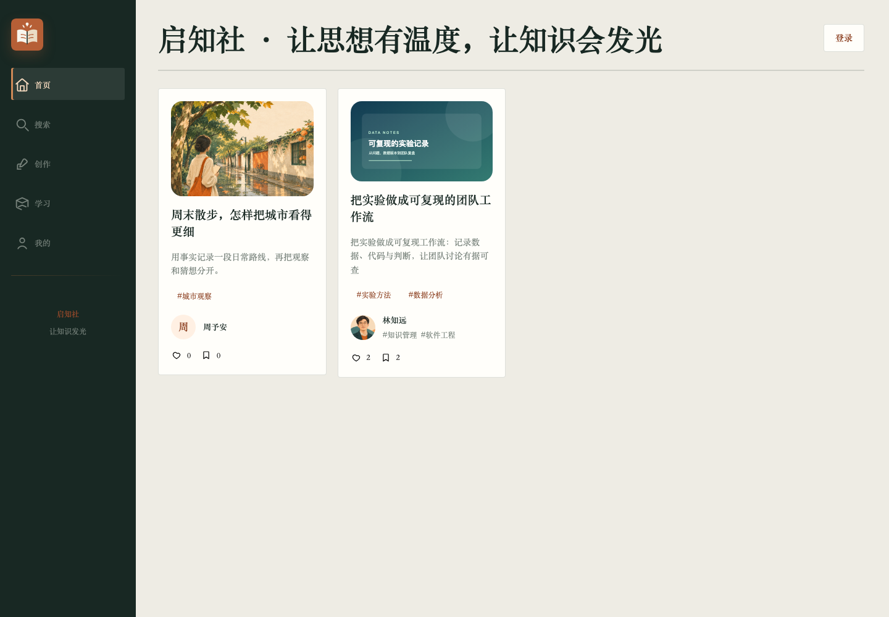
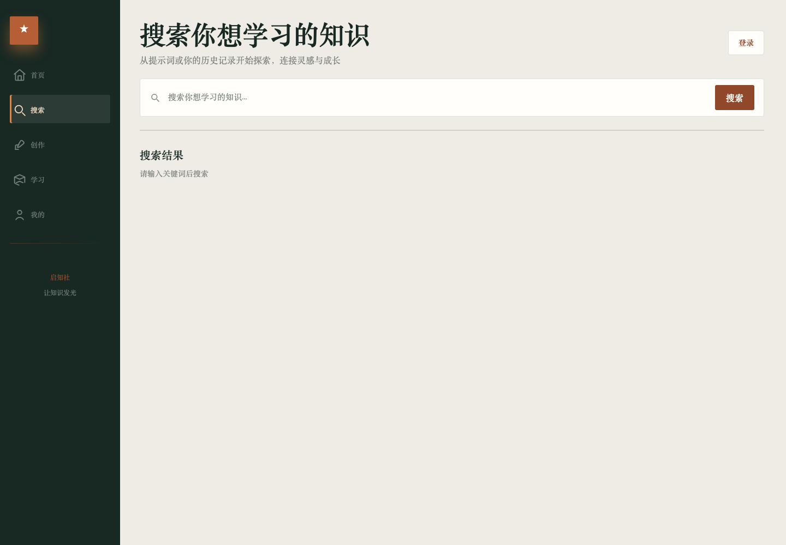
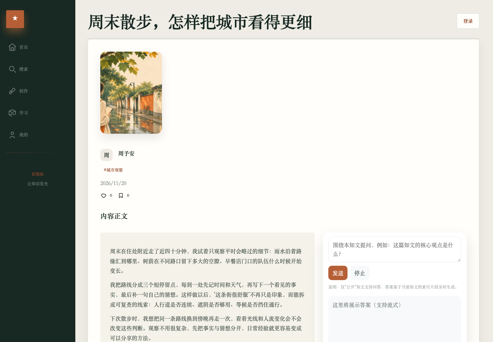
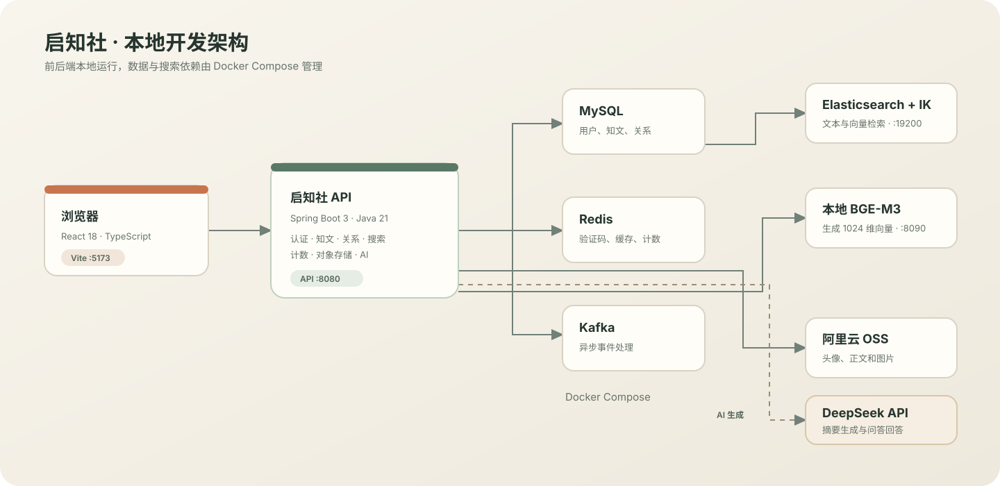

# 启知社（qi_zhi_she）

启知社是一个高校知识分享社区，支持发布和阅读知文、搜索、关注作者、点赞收藏，以及知文 AI 问答。仓库包含 React 前端和 Spring Boot 后端；本地依赖服务由 Docker Compose 启动。

## 前端界面

截图来自本地运行的前端；首页和详情页里的知文是本地生成的示例内容。



<details>
<summary>查看搜索页与知文详情页</summary>





</details>

系统架构图：



## 本地运行

### 需要准备

- Docker Desktop 和 Docker Compose
- JDK 21、Maven、Node.js 18+ 和 npm
- Python 3.10+
- BGE-M3 模型文件，放在项目根目录 `models/bge-m3/`（模型权重不随仓库分发）

应用配置集中在 `backend/src/main/resources/application.yml`，不使用 `.env`。运行前生成本机 JWT 密钥：

```bash
mkdir -p backend/.local/keys
openssl genpkey -algorithm RSA -pkeyopt rsa_keygen_bits:2048 \
  -out backend/.local/keys/private.pem
openssl pkey -in backend/.local/keys/private.pem -pubout \
  -out backend/.local/keys/public.pem
```

仓库中的 DeepSeek 与 OSS 凭据字段是占位符。请在本机 `application.yml` 填入自己的值；真实密钥不要提交到 Git。

使用 AI 摘要和问答时，在 `application.yml` 配置 `spring.ai.deepseek.api-key`。BGE-M3 在本地生成向量，不需要 OpenAI Embeddings。上传头像、图片或正文还需配置 `oss.access-key-id`、`oss.access-key-secret`、Bucket 和 Endpoint。浏览器直传时，Bucket CORS 需允许开发来源 `http://127.0.0.1:5173` 及应用所需的方法和请求头；生产环境应限制来源。

### 启动步骤

从仓库根目录依次启动依赖服务：

```bash
docker compose up -d --build
docker compose ps
```

启动本地向量服务（需先放好模型文件；首次安装 Python 依赖需要网络）：

```bash
python3 -m venv backend/local-embedding/.venv
backend/local-embedding/.venv/bin/pip install -r backend/local-embedding/requirements.txt
backend/local-embedding/.venv/bin/python backend/local-embedding/server.py
```

在另一个终端启动后端：

```bash
cd backend
mvn spring-boot:run
```

再开一个终端启动前端：

```bash
cd frontend
npm ci
npm run dev
```

打开 <http://127.0.0.1:5173>。后端健康检查为 <http://127.0.0.1:8080/actuator/health>，本地嵌入服务健康检查为 <http://127.0.0.1:8090/health>。本地验证码会写入运行后端的终端日志；这不是生产短信/邮件服务。

| Docker 服务 | 本机端口 | 用途 |
| --- | ---: | --- |
| MySQL | `13306` | 用户、知文和关系数据 |
| Redis | `16379` | 验证码、缓存和计数 |
| Kafka | `19092` | 异步事件处理 |
| Elasticsearch + IK | `19200` | 文本搜索和向量检索 |

停止容器但保留数据：`docker compose down`。删除本地数据卷：`docker compose down -v`（会清空本地数据库、缓存、Kafka 和搜索索引）。MySQL 初始表结构 `backend/db/schema.sql` 只会在首次创建数据卷时执行。

## 功能概览

- 手机号/邮箱验证码注册登录、个人资料和头像
- 知文草稿、正文确认、发布、可见范围和置顶管理
- 首页阅读、知文详情、搜索与搜索建议
- 用户关注关系、点赞收藏、关注/粉丝列表与计数
- DeepSeek 摘要生成和知文流式问答；本地 BGE-M3 嵌入及 Elasticsearch 向量检索
- 学习记录

本地 Compose 不含 Canal，Outbox 事件保留在 MySQL；单机开发不需要 Canal Server。

## 项目结构

```text
frontend/                 React 18、TypeScript、Vite 前端
backend/                  Java 21、Spring Boot 3 后端
  src/main/java/com/tongji/  认证、知文、关系、计数、搜索、存储和 AI 模块
  db/schema.sql           MySQL 初始结构
  local-embedding/        本地 BGE-M3 服务
docker/                   Elasticsearch 与 IK 插件镜像配置
docker-compose.yml        本地依赖服务
models/bge-m3/            本地模型目录（Git 忽略）
docs/images/              README 架构图和前端页面截图
```

前端页面：`/` 首页、`/search` 搜索、`/create` 发布、`/learn` 学习、`/profile` 个人主页、`/profile/edit` 编辑资料、`/post/:id` 知文详情、`/login` 登录、`/register` 注册。后端 API 使用 `/api/v1` 前缀。

## 开发检查

```bash
cd frontend && npm run lint && npm run build
cd ../backend && mvn test
```

## 文档

- [后端 API 总览](backend/docs/API接口.md)
- [知文 API](backend/docs/API接口文档_knowpost.md)
- [用户关系 API](backend/docs/API接口文档_用户关系.md)
- [计数 API](backend/docs/API接口文档_计数.md)
- [前端 API 文档](frontend/docs/)
- [Elasticsearch 与 IK 配置](docker/elasticsearch/README.md)

提交或推送代码前，检查 `application.yml` 和 Git 暂存区，确保 DeepSeek Key、OSS Secret、JWT 私钥等真实凭据没有进入远程仓库。
